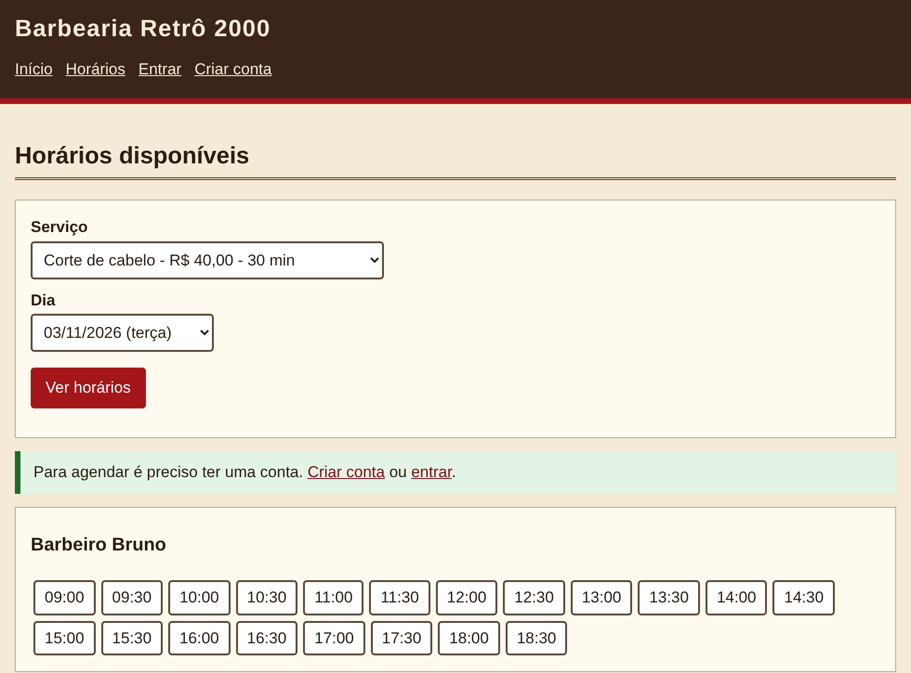
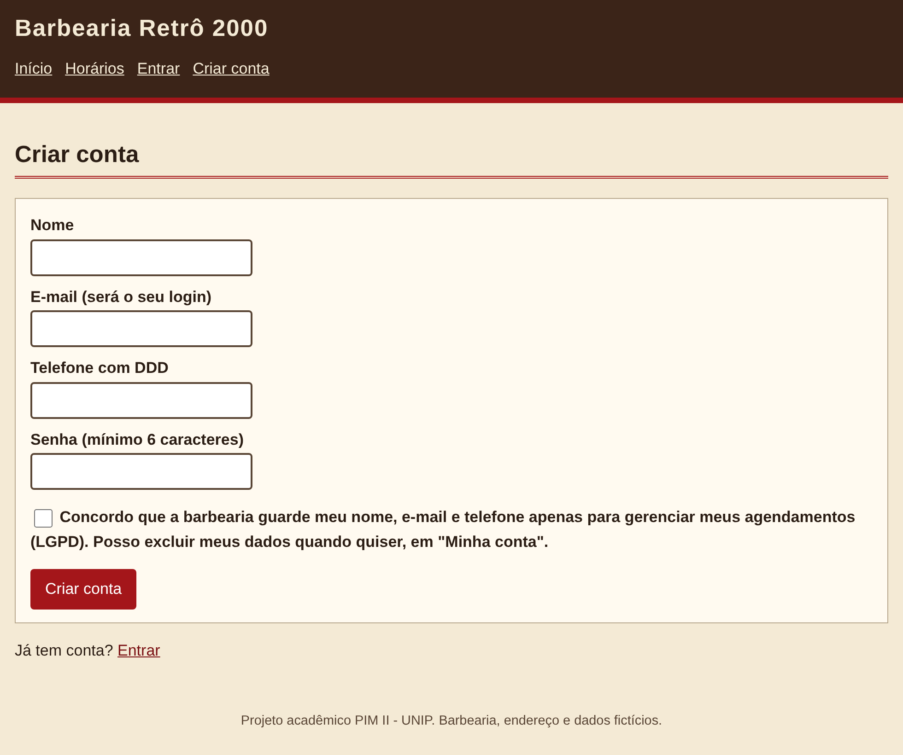
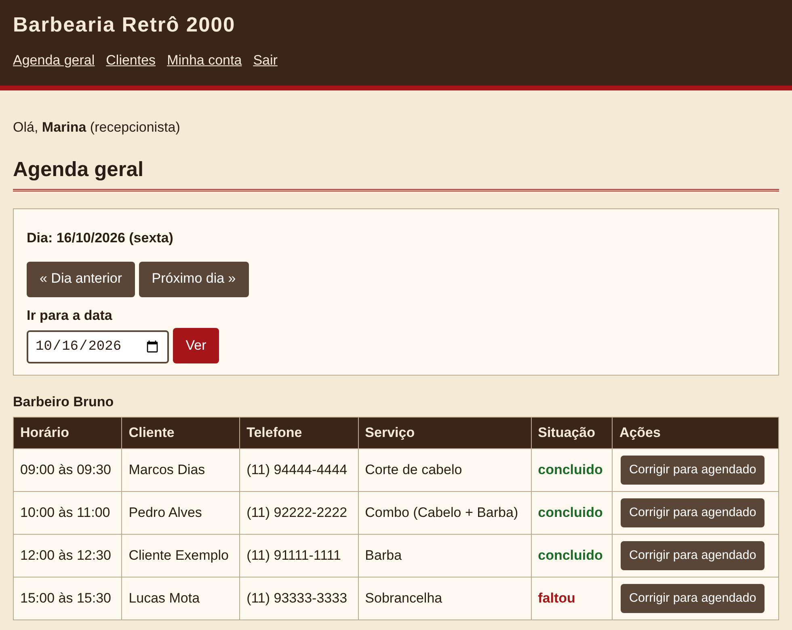

# Barbearia Retrô 2000 — sistema de agendamento

Protótipo de agendamento online para a **Barbearia Retrô 2000** (empresa **fictícia**, Sacomã, São Paulo), feito em **C** com **SQLite** no **PIM II** do curso de Análise e Desenvolvimento de Sistemas da UNIP (2026).

> Projeto acadêmico, com dados fictícios. É um protótipo que roda em um só computador, não um sistema em produção.

## Telas

| Horários livres | Cadastro com consentimento (LGPD) | Agenda geral (recepção) |
|---|---|---|
|  |  |  |

## O que o sistema faz

- Servidor HTTP próprio, escrito com sockets em C (`127.0.0.1:8080`).
- Quatro perfis: cliente, barbeiro, recepcionista e dono, cada um com suas telas.
- Cliente escolhe serviço, dia, barbeiro e horário; os horários livres aparecem separados por barbeiro (blocos de 30 minutos).
- Não aceita dois agendamentos no mesmo horário do mesmo barbeiro (verificação dentro de uma transação).
- Cancelamento com antecedência mínima configurável (2 h) e bloqueio de horários (folga, almoço).
- Recepção agenda também clientes que ligam por telefone.
- Segurança: senhas com hash SHA-256 e sal individual, consultas parametrizadas, escape de HTML, cookie de sessão `HttpOnly` e `SameSite=Strict`, sessão que expira em 2 h.
- LGPD: consentimento no cadastro, correção de dados e exclusão da conta.

## Como executar

> **Atenção:** os arquivos do SQLite (`sqlite3.c` e `sqlite3.h`) **não estão neste repositório**. É preciso baixá-los separadamente (passo 2 abaixo) antes de compilar.

1. Instale o compilador **gcc** (no Windows, por exemplo, o MinGW-w64).
2. Baixe o **SQLite amalgamation** (arquivo `sqlite-amalgamation-*.zip`, na seção "Source Code") em <https://www.sqlite.org/download.html>, extraia e copie `sqlite3.c` e `sqlite3.h` para esta pasta.
3. Compile: `compilar.bat` (Windows) ou `./compilar.sh` (Linux/Mac).
4. Inicie: `iniciar.bat` ou `./barbearia 8080`.
5. Abra <http://localhost:8080>. Na primeira vez o banco `barbearia.db` é criado sozinho, com usuários de **exemplo** (veja o `LEIAME.txt`). Troque as senhas na tela "Minha conta".

## Limitações

Atende um pedido por vez; não tem HTTPS, backup automático, política de privacidade, autenticação em dois fatores nem envio de notificações. A rede e a hospedagem em nuvem foram só propostas no trabalho.

## Equipe

Guilherme Souza dos Santos · João Emannuel Lopes de Souza · Kayky de Oliveira Dantas dos Santos · Lucas do Monte Pereira da Silva · Matheus Lima Araujo — orientador: Fábio de Assis.

## Uso de inteligência artificial

Usamos o Claude (Anthropic) como apoio em pesquisas, na organização do cronograma, na definição dos requisitos e no desenvolvimento do protótipo, e para explicar o código ao grupo. O grupo escolheu o escopo, revisou os textos e testou o código.

## Licença

MIT — veja `LICENSE`.
